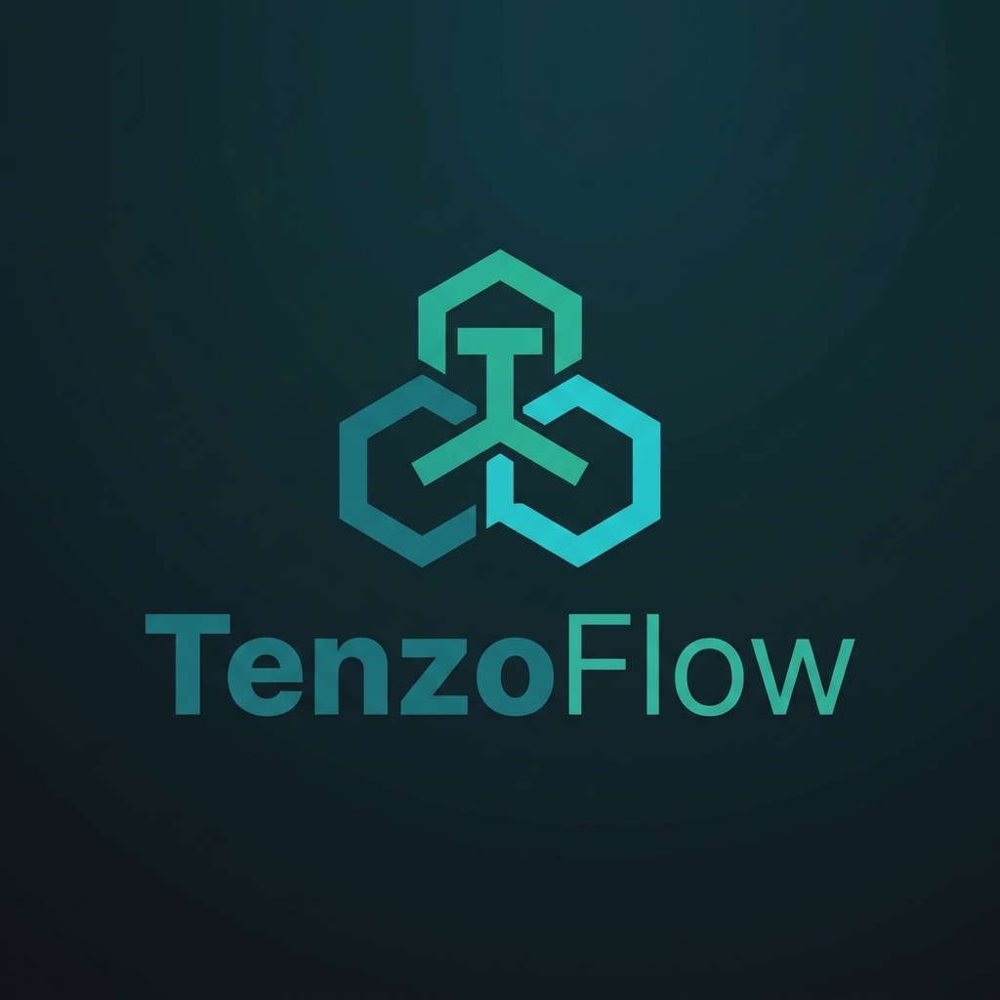

# TenzoFlow
> Your **personal** focus. Scale for the **entire team.**



Backend на Go: менеджер задач с проектами, который растёт от личного todo до командного трекера.

**Статус:** фундамент (конфиг, логи, HTTP-сервер, БД и миграции). Бизнес-логика (регистрация, проекты, задачи) пишется следующими шагами, см. [Дорожную карту](#дорожная-карта).

---

## Быстрый старт

Нужны: Go и (для Postgres) Docker.

```bash
go mod tidy                 # подтянуть зависимости

task run                    # SQLite, ничего больше ставить не нужно
curl localhost:8997/healthz # {"status":"ok"}
```

Остановка: `Ctrl+C`. Сервер дорабатывает текущие запросы и закрывает БД (graceful shutdown).

### То же самое, но с PostgreSQL (в Docker)

```bash
task run:pg                 # поднимет Postgres в Docker и запустит API
task db:psql                # SQL-консоль внутри контейнера
task db:down                # остановить (данные сохраняются)
task db:reset               # остановить и УДАЛИТЬ данные
```

Postgres на компьютер ставить не нужно: он живёт в контейнере (`../../Downloads/tenzoflow-update/tenzoflow/docker-compose.yaml`) и слушает только `127.0.0.1:5432`.

Все команды: `task --list`.

---

## Какая БД где

| Окружение | БД | Конфиг | Зачем |
|---|---|---|---|
| Разработка | SQLite (файл `data/app.db`) | `../../Downloads/tenzoflow-update/tenzoflow/cfg/local.yaml` | ноль настроек, быстро |
| Проверка на «боевой» БД | PostgreSQL в Docker | `../../Downloads/tenzoflow-update/tenzoflow/cfg/local-pg.yaml` | поймать расхождения диалектов до продакшена |
| Прод | PostgreSQL | `../../Downloads/tenzoflow-update/tenzoflow/cfg/prod.yaml` + переменные окружения | надёжность, много соединений |

Выбор делает одно поле: `database.driver: sqlite | postgres`.

---

## Конфигурация

Приоритет (от низшего к высшему): значения по умолчанию в коде → YAML-файл → переменные окружения.

Путь к YAML: флаг `--config ./cfg/local.yaml` или переменная `CONFIG_PATH`.
Если конфиг неверный, программа не запустится и покажет **все** проблемы сразу.

| YAML | Переменная окружения | По умолчанию | Описание |
|---|---|---|---|
| `server.host` | `SERVER_HOST` | `localhost` | адрес |
| `server.port` | `SERVER_PORT` | обязателен | порт |
| `server.timeout` | `SERVER_TIMEOUT` | `5s` | таймаут чтения/записи запроса |
| `server.idle_timeout` | `SERVER_IDLE_TIMEOUT` | `60s` | как долго держать неактивное соединение |
| `server.shutdown_timeout` | `SERVER_SHUTDOWN_TIMEOUT` | `30s` | сколько ждать завершения запросов при остановке |
| `database.driver` | `DB_DRIVER` | `sqlite` | `sqlite` или `postgres` |
| `database.sqlite.path` | `DB_SQLITE_PATH` | `./data/app.db` | путь к **файлу** базы |
| `database.postgres.host` | `DB_PG_HOST` | `localhost` | |
| `database.postgres.port` | `DB_PG_PORT` | `5432` | |
| `database.postgres.user` | `DB_PG_USER` | обязателен | |
| `database.postgres.password` | `DB_PG_PASSWORD` | обязателен | **секрет**: только через окружение |
| `database.postgres.name` | `DB_PG_NAME` | обязателен | |
| `database.postgres.sslmode` | `DB_PG_SSLMODE` | `disable` | в проде `require` или `verify-full` |
| `database.postgres.max_open_conns` | `DB_PG_MAX_OPEN_CONNS` | `10` | лимит соединений пула |
| `database.postgres.max_idle_conns` | `DB_PG_MAX_IDLE_CONNS` | `5` | |
| `database.postgres.conn_max_lifetime` | `DB_PG_CONN_MAX_LIFETIME` | `30m` | |
| `logger.env` | `LOG_ENV` | обязателен | `local` (цветной текст) или `prod` (JSON) |
| `logger.level` | `LOG_LEVEL` | debug / info | `debug`, `info`, `warn`, `error` |

Правила, которые легко нарушить:
- Пути в конфиге: относительные от места запуска или абсолютные. **`~` Go не раскрывает.**
- Пароль БД не хранить в YAML, который лежит в git.

---

## Логирование

Используется стандартный `log/slog`.

- `local`: цветной текст, уровень `debug`. `prod`: JSON, уровень `info`, с указанием файла и строки.
- **`request_id`** добавляется в лог автоматически, если использовать `log.InfoContext(ctx, ...)` (а не `log.Info(...)`). Идентификатор берётся из заголовка `X-Request-Id` (если он безопасный) или генерируется, и возвращается клиенту в заголовке ответа.
- На каждый запрос пишется одна строка `http request`: метод, путь, статус, размер, длительность, IP. Уровень зависит от статуса: 5xx = `ERROR`, 4xx = `WARN`, `/healthz` = `DEBUG` (чтобы проверки не засоряли лог).
- Пароли, токены, query-строки и тела запросов в лог **не пишутся**. Конфиг БД логируется без пароля.
- Паника в обработчике перехватывается: клиент получает `500`, в лог пишется стек.

---

## Миграции

SQL-файлы вшиты в программу (`go:embed`) и применяются автоматически при старте. Применённые версии хранятся в таблице `goose_db_version`.

```
internal/storage/sqlite/migrations/     00001_init.sql
internal/storage/postgres/migrations/   00001_init.sql
```

Схемы для двух БД ведутся **раздельно**, потому что диалекты различаются (автоинкремент, типы времени, булевы значения). Логически они должны оставаться одинаковыми.

Как добавить изменение:
1. Создай **новый** файл с следующим номером в **обеих** папках: `00002_add_tags.sql`.
2. Напиши `-- +goose Up` (изменение) и `-- +goose Down` (откат).
3. Перезапусти программу (при `go run` пересборка автоматическая).

**Нельзя редактировать уже применённую миграцию**, даже у себя на ноутбуке: goose не запустит её повторно, и базы незаметно разойдутся. Любая правка это новый файл.

Особенности SQLite, о которых нужно знать:
- Внешние ключи по умолчанию выключены. Здесь они включены в DSN при открытии каждого соединения, иначе `ON DELETE CASCADE` молча не работает.
- Даты хранятся строками RFC 3339 в UTC; в Postgres это `TIMESTAMPTZ`.

---

## Структура проекта

```
cmd/api/main.go                  точка входа: сборка зависимостей, запуск, graceful shutdown
cfg/                             local.yaml, local-pg.yaml, prod.yaml
internal/
  config/                        загрузка, значения по умолчанию, валидация
  logger/                        slog: форматы, уровни, request_id из контекста
  storage/
    storage.go                   выбор БД по конфигу + миграции
    migrate/                     запуск goose (общий для обеих БД)
    sqlite/                      подключение и миграции SQLite
    postgres/                    подключение и миграции PostgreSQL
  transport/rest/                роутер, middleware, JSON-ответы
  domain/                        (пока пусто) сущности и ошибки предметной области
  service/                       (пока пусто) бизнес-логика
docker-compose.yaml              PostgreSQL для разработки и интеграционных тестов
Taskfile.yaml                    команды: run, test, db:up, ...
```

Правило зависимостей (стрелка = «знает о»):

```
transport/rest → service → domain
                    ↓
          интерфейсы репозиториев
                    ↑
        storage/{sqlite,postgres}
```

`domain` ни от чего не зависит; `service` не знает про HTTP и SQL; `transport` не знает про SQL.

---

## Тесты

```bash
task test               # юнит-тесты, Docker не нужен
task test:race          # с детектором гонок (нужен gcc / cgo)
task test:integration   # тесты на настоящем PostgreSQL (запускает Docker)
```

Интеграционные тесты помечены тегом сборки `integration`, поэтому обычный `go test ./...` их не запускает. Каждый такой тест создаёт собственную временную базу и удаляет её после себя: ваши данные в dev-базе не затрагиваются. Если Docker не запущен, тест пропускается с подсказкой.

Что проверяется сейчас: валидация конфига, экранирование пароля в строке подключения, отсутствие пароля в логах, `request_id` в логах (в том числе после `logger.With(...)`), middleware (id, паника, уровни логов), схемы обеих БД (каскадное удаление, `CHECK`-ограничения, уникальность личного workspace, повторный запуск миграций).

---

## Дорожная карта

Подробное ТЗ и чек-лист приёмки MVP лежат отдельно (`taskboard-tz.md`, `taskboard-checklist.md`).

1. ✅ Фундамент: конфиг, логи, HTTP-скелет, SQLite + PostgreSQL, миграции.
2. 🔜 Регистрация: `domain`, репозиторий пользователей, bcrypt, транзакция «пользователь + личный workspace».
3. 🔜 Вход, сессии, auth-middleware, `GET /me`.
4. 🔜 Workspace, проекты, задачи, доска.
5. 🔜 Тесты безопасности (изоляция данных между пользователями), README с примерами `curl`.

### Важное архитектурное решение на следующий шаг: репозитории

SQL у SQLite и Postgres отличается (плейсхолдеры `?` и `$1`, типы времени), поэтому репозитории описываются **интерфейсами в `service`**, а реализации лежат отдельно: `storage/sqlite` и `storage/postgres`. `service` не знает, с какой БД работает. Начинаем с SQLite, реализация для Postgres добавляется следом и проверяется теми же тестами.

### Что стоит сделать перед продакшеном

- Если приложение запускается в нескольких экземплярах: защитить миграции блокировкой (advisory lock в goose), иначе они гонятся друг с другом.
- `Dockerfile` для самого приложения (сейчас в Docker живёт только PostgreSQL).
- Проверка готовности (`/readyz`) с проверкой БД, отдельно от `/healthz`.
- `golangci-lint` с конфигом, CI.
